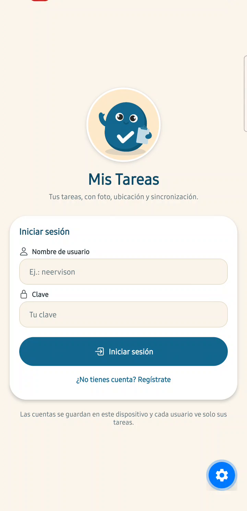
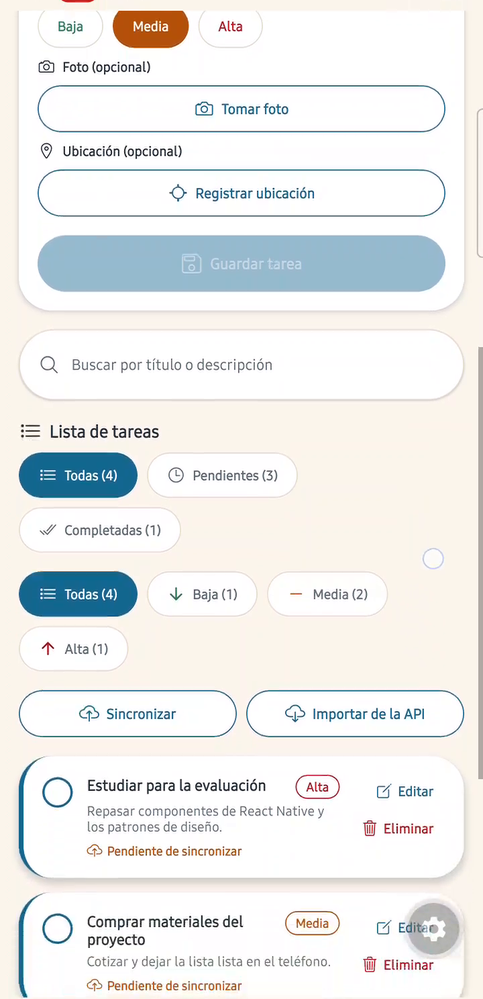
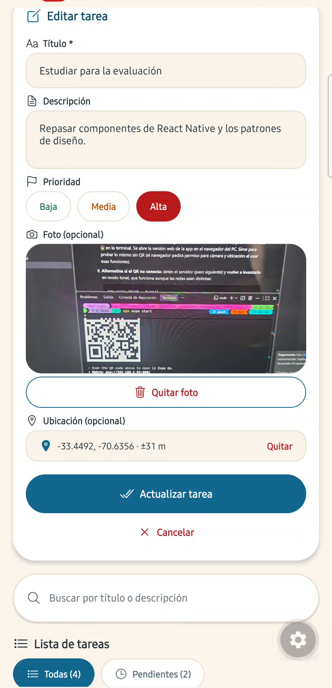
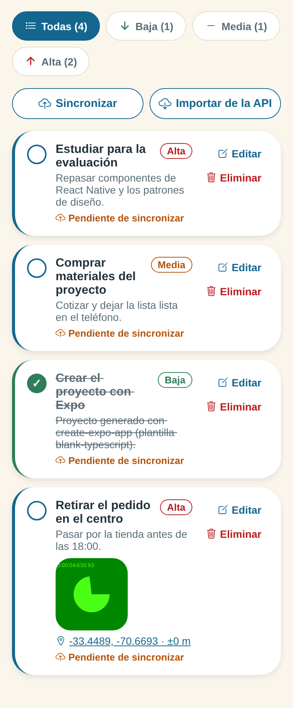

# Mis Tareas — Lista de tareas con cámara, GPS y sincronización (Expo y React Native)

**Asignatura:** IF206IINF Desarrollo de Aplicaciones Móviles
**Integrantes:** Neervison Bonny Laguna Sánchez, Ignacio Arancibia Arce, Joaquín Gallardo Larrere
**Proyecto:** Aplicación móvil de lista de tareas (To-Do List) que amplía la primera versión: **agregar, editar, eliminar y marcar completadas**, cada tarea con **título, descripción y prioridad**, **foto adjunta con la cámara**, **ubicación GPS registrada al crearla**, **búsqueda y filtros**, **cuentas de usuario con listas separadas**, **almacenamiento local que funciona sin conexión** y **sincronización con una API externa** (importar y subir cambios, con cola offline).

> **Continuidad tecnológica:** este proyecto continúa la elección inicial de la primera parte: **Expo con React Native y TypeScript**. No se cambió de tecnología a mitad de camino: la sección [¿Por qué usamos estas tecnologías?](#por-qué-usamos-estas-tecnologías) explica qué aporta cada librería nueva y por qué se usa aquí, y la tabla [Componentes de la interfaz](#componentes-de-la-interfaz-y-su-implementación-en-este-proyecto) muestra cómo se construyó cada pieza de la pantalla.

Este README está ordenado **por pasos, desde cero**: si sigues los pasos 1 al 12 entiendes cómo se amplió la app, por qué se hizo así y cómo probarla. Para probarla tú mismo en tu PC, ve directo a la sección **[Cómo probar el código tú mismo](#cómo-probar-el-código-tú-mismo)**.

---

## Capturas de la aplicación

Las cuatro capturas son **reales: tomadas de la app ejecutándose** (build web de Expo en el navegador, manejando la interfaz de verdad: registro de usuario, creación de una tarea, registro de ubicación y toma de foto). La cámara y la ubicación estaban **emuladas por el navegador**: la foto muestra el patrón de imagen de la cámara de prueba y las coordenadas son las de Santiago configuradas en la emulación. Ninguna captura usa emoticones: los iconos son **vectoriales profesionales (Ionicons)**.

### Captura 1 — Inicio de sesión



**Qué se ve y qué demuestra:** la puerta de entrada de la app. La mascota saluda en su insignia circular sobre el título, con los colores verde azulado y crema que ordenan toda la interfaz. El formulario pide **nombre de usuario y clave** (la clave se escribe oculta), el botón «Iniciar sesión» y el cambio a **«¿No tienes cuenta? Regístrate»** para crear una cuenta nueva. Debajo, la nota aclara el alcance: las cuentas se guardan en el dispositivo y cada usuario ve solo sus tareas. Demuestra la **autenticación multiusuario**: sin sesión no se ve ninguna lista, y al entrar cada usuario encuentra la suya.

### Captura 2 — Lista, filtros, búsqueda y sincronización



**Qué se ve y qué demuestra:** la pantalla principal ampliada. El formulario «Nueva tarea» ahora incluye **chips de prioridad** (Baja/Media/Alta) y las secciones **Foto (opcional)** y **Ubicación (opcional)** con sus botones. Debajo van la **barra de búsqueda**, los **chips de filtro por estado** con conteos (Todas (3), Pendientes (2), Completadas (1)), los **chips de filtro por prioridad** con conteos, y los botones **«Sincronizar»** e **«Importar de la API»**. Las tarjetas llevan la **insignia de prioridad** con su color y la etiqueta ámbar **«Pendiente de sincronizar»**: la app muestra siempre qué falta por subir. En conjunto, la captura evidencia la lista ampliada completa: prioridad, búsqueda, filtros y estado de sincronización visibles de un vistazo.

### Captura 3 — Formulario con foto y GPS registrados



**Qué se ve y qué demuestra:** el formulario llenándose con una tarea real. El título «Retirar el pedido en el centro», la descripción, la prioridad **Alta** seleccionada en rojo, la **vista previa de la foto** recién capturada con la cámara (patrón de la cámara de prueba del navegador) con su botón «Quitar foto», y la fila de ubicación con las **coordenadas registradas por el GPS** («-33.4489, -70.6693 · ±0 m») y su opción «Quitar». Demuestra las dos funciones de periféricos juntas en el mismo flujo: **cámara + GPS**, ambas opcionales y quitables antes de guardar.

### Captura 4 — Tarea guardada con foto, coordenadas y marca de pendiente



**Qué se ve y qué demuestra:** la lista después de guardar. La tarea nueva («Retirar el pedido en el centro», prioridad Alta) muestra su **miniatura de foto**, el **enlace de coordenadas** que abre el lugar en mapas al tocarlo, y la etiqueta **«Pendiente de sincronizar»**: el cambio está guardado en el teléfono y en la cola para subir a la API. Las tres tareas de ejemplo también muestran su prioridad y su marca de pendiente, y arriba quedan los botones de sincronización. Demuestra el ciclo completo: **capturar → guardar local → ver el estado de sincronización** en la propia tarjeta.

---

## Paso 1 — Instalar Node.js (el entorno de trabajo)

**Qué se hace:** instalar Node.js 20 o superior desde https://nodejs.org y verificar con:

```bash
node -v
```

**Por qué:** Node.js **no es la app**: es el entorno que ejecuta las herramientas JavaScript del proyecto. Sin Node no funcionan `npm`/`npx`, que son los comandos con los que se instalan dependencias, se levanta la app y se corren las pruebas.

**Qué debería verse:** un número de versión, por ejemplo `v24.22.1` (la versión con la que se probó este proyecto; ver Paso 12).

---

## Paso 2 — Partir de la primera versión (la base)

**Qué se hace:** este proyecto parte del código de la primera versión (misma estructura `src/`, mismo sistema de tema con tokens, mismo hook de tareas) y lo amplía: el modelo de tarea crece con prioridad, foto, ubicación y datos de sincronización, y aparecen la capa de servicios, las pantallas de autenticación y cámara, y las pruebas con Jest. No se reescribió la app: se continuó.

**Por qué:** cambiar de tecnología o reescribir a mitad de un proyecto rompe lo que ya funciona y obliga a rehacer las pruebas. La ampliación conserva la interfaz y los patrones de la primera versión (componentes presentacionales, hook de lógica, tema con tokens) y suma las funciones nuevas en archivos propios, con una sola responsabilidad cada uno.

**Qué debería verse:** una carpeta `mis-tareas-expo-u2/` con `App.tsx`, `index.ts`, `app.json`, `package.json`, `tsconfig.json`, `src/` y `tests/`.

---

## Paso 3 — Instalar las dependencias nuevas

**Qué se hace** (dentro de la carpeta del proyecto):

```bash
npx expo install expo-camera expo-location expo-crypto expo-haptics expo-network @react-native-async-storage/async-storage
npm install --save-dev jest jest-expo @types/jest
```

**Por qué `npx expo install`:** resuelve las versiones compatibles con el SDK del proyecto (Expo SDK 58). Instalar con `npm install` a secas podría traer una versión incompatible con el SDK y romper la app en el teléfono.

**Qué debería verse:** termina sin errores y `package.json` lista las dependencias nuevas (ver la tabla de tecnologías). La carpeta `node_modules/` **no se entrega**: se regenera con `npm install`.

---

## Paso 4 — Configurar los permisos en `app.json`

**Qué se hace:** declarar los plugins de configuración de cámara y ubicación con sus mensajes en español:

```json
"plugins": [
  ["expo-camera", { "cameraPermission": "Mis Tareas usa la cámara solo para adjuntar una foto a tus tareas." }],
  ["expo-location", { "locationWhenInUsePermission": "Mis Tareas registra la ubicación donde creas cada tarea." }]
]
```

**Por qué:** en Android e iOS, la cámara y la ubicación exigen declarar el permiso y explicar para qué se usará: sin esta declaración, el sistema niega el permiso aunque la app lo pida bien. El mensaje que ve el usuario al pedir el permiso sale de aquí, por eso está en español y dice exactamente para qué se usa cada permiso.

---

## Paso 5 — Ordenar la estructura de carpetas

**Qué se hace:** mantener la estructura por responsabilidad de la primera versión y sumar las piezas nuevas (servicios, pantallas, pruebas):

```
mis-tareas-expo-u2/
├── App.tsx                  ← Raíz de composición + puerta de sesión (con SafeAreaProvider)
├── index.ts                 ← Punto de entrada: registra App en Expo (no se toca)
├── app.json                 ← Configuración (nombre "Mis Tareas", plugins de cámara y ubicación)
├── package.json             ← Dependencias y scripts (start, web, typecheck, lint, test, export:web)
├── tsconfig.json            ← Configuración de TypeScript (modo estricto)
├── eslint.config.js         ← Reglas de ESLint (configuración oficial de Expo)
├── README.md                ← Este documento
├── README-visual.html       ← Este documento en HTML, con las capturas incrustadas
├── assets/                  ← Iconos de la app y mascota.png (la mascota)
├── capturas/                ← Capturas reales de la app (las de este README)
├── tests/                   ← Pruebas Jest de los servicios (42 pruebas, 10 suites)
└── src/
    ├── pantallas/
    │   ├── PantallaTareas.tsx        ← La PANTALLA completa: compone todo, sesión, filtros, sincronización
    │   ├── PantallaAutenticacion.tsx ← Entrada y registro de usuarios (dos modos, un formulario)
    │   └── PantallaCamara.tsx        ← Visor de cámara en modal (CameraView + botón de captura)
    ├── componentes/                  ← Piezas de interfaz reutilizables (solo dibujan)
    │   ├── Encabezado.tsx            ← Saludo según la hora + título + resumen + la mascota
    │   ├── Mascota.tsx               ← La mascota (imagen en insignia circular) que anima según el avance
    │   ├── BarraProgreso.tsx         ← Barra animada de % completado + mensaje dinámico
    │   ├── BarraSesion.tsx           ← Saludo al usuario + botón Salir
    │   ├── IndicadorConexion.tsx     ← Píldora "En línea" / "Sin conexión"
    │   ├── FiltrosTareas.tsx         ← Chips Todas / Pendientes / Completadas con conteos
    │   ├── FiltroPrioridad.tsx       ← Chips de prioridad con conteos y color propio
    │   ├── BarraBusqueda.tsx         ← Campo de búsqueda con lupa y botón limpiar
    │   ├── FormularioTarea.tsx       ← Formulario: crear/editar + prioridad + foto + ubicación
    │   ├── TareaItem.tsx             ← Tarjeta: checkbox, prioridad, foto, ubicación, pendiente, acciones
    │   ├── EstadoVacio.tsx           ← Mensaje cuando la lista se ve vacía (según filtro o búsqueda)
    │   └── index.ts                  ← "Barrel": re-exporta todos los componentes
    ├── hooks/
    │   ├── useTareas.ts              ← La LÓGICA: estado, persistencia, cola y sincronización
    │   ├── useSesion.ts              ← La sesión activa: entrar, registrar, salir
    │   └── useEstadoRed.ts           ← Estado de la red actualizado (lectura + suscripción)
    ├── servicios/                    ← CAPA DE SERVICIOS: reglas y periféricos, sin pantallas
    │   ├── almacenamiento.ts         ← AsyncStorage: guardar/leer/borrar JSON, claves por usuario
    │   ├── autenticacion.ts          ← Registro/inicio de sesión, hash SHA-256 con sal, sesión
    │   ├── permisos.ts               ← Permisos incrementales con explicación y respeto a denegación
    │   ├── foto.ts                   ← Captura de foto (cámara inyectada) y formato data URI
    │   ├── ubicacion.ts              ← Lectura GPS con tiempo límite, enlace y texto de mapas
    │   ├── apiTareas.ts              ← Cliente REST (GET/POST/PUT/DELETE, timeout, validación)
    │   ├── sincronizacion.ts         ← Cola offline-first, vaciado y mezcla por fecha
    │   ├── dispositivo.ts            ← Vibración (Haptics) y estado de la red (Network)
    │   ├── tareas.ts                 ← Persistencia de tareas, siembra y construcción inmutable
    │   ├── validacionTarea.ts        ← Reglas puras: título obligatorio y normalización (trim)
    │   └── filtradoTareas.ts         ← Reglas puras: filtro por estado, prioridad y búsqueda
    ├── modelos/
    │   ├── tarea.ts                  ← Tarea, DatosTarea, Prioridad, UbicacionTarea, filtros
    │   └── usuario.ts                ← Usuario, Sesion y ElementoCola
    ├── constantes/
    │   ├── limites.ts                ← Límites con nombre (título, descripción, nombre y clave)
    │   └── mensajes.ts               ← Textos dinámicos + explicaciones de permisos + vacío de búsqueda
    ├── utilidades/
    │   └── ids.ts                    ← generarId(): crea el id único de cada tarea
    └── tema/                         ← TOKENS DE DISEÑO (valores con nombre, un solo lugar)
        ├── colores.ts                ← Paleta + colores de aviso y de prioridad
        ├── espaciado.ts              ← Espaciados (8/16/24/32) y radios
        ├── tipografia.ts             ← Escala de tamaños de fuente
        └── index.ts                  ← "Barrel": re-exporta todos los tokens
```

**Por qué:** cada carpeta responde a una pregunta: **pantallas** = ¿qué pantalla se muestra? · **componentes** = ¿cómo se ve? · **hooks/servicios** = ¿qué hace y qué reglas cumple? · **modelos** = ¿cómo son los datos? · **tema** = ¿con qué estilo? La novedad es la **capa de servicios**: todo lo que habla con el dispositivo o con la red vive en `src/servicios/`, y ningún componente importa directamente una librería de hardware o de red. Así cada servicio se prueba solo, con dobles, sin pantalla ni teléfono.

---

## Paso 6 — El modelo de datos extendido: `src/modelos/tarea.ts` y `usuario.ts`

**Qué se hace:** la tarea de la primera versión (título, descripción, estado) crece sin romper los campos originales:

```typescript
export interface Tarea {
  id: string;
  usuarioId: string;          // dueño de la tarea: separa las listas
  titulo: string;
  descripcion: string;
  prioridad: Prioridad;       // 'baja' | 'media' | 'alta'
  completada: boolean;
  fechaCreacion: number;
  actualizadaEn: number;      // último cambio: decide la mezcla al sincronizar
  fotoUri: string | null;     // foto como data URI en base64
  ubicacion: UbicacionTarea | null; // latitud, longitud, precisión, fecha
  idRemoto: number | null;    // id que la API le dio a la tarea
  pendienteSync: boolean;     // true = falta subir un cambio local
}
```

El modelo de usuario (`src/modelos/usuario.ts`) define `Usuario` (con `hashClave` y `sal`, nunca la clave), `Sesion` (con token) y `ElementoCola` (operación pendiente: crear, actualizar o eliminar, con su copia de datos).

**Por qué:** los campos nuevos son exactamente los que piden las funciones nuevas, y cada uno tiene un dueño claro: la foto y la ubicación pertenecen a la tarea; el id remoto y la marca de pendiente pertenecen al puente con la API; la fecha de actualización pertenece a la mezcla. Con tipos, si una tarea llega sin `usuarioId`, TypeScript avisa antes de correr la app.

---

## Paso 7 — La capa de servicios: `src/servicios/`

Cada servicio tiene una sola responsabilidad y **no dibuja nada**: recibe datos, hace su trabajo y devuelve un resultado. La pantalla y los hooks solo los usan.

| Servicio | Qué hace | Decisiones clave |
|---|---|---|
| `almacenamiento.ts` | Guarda/lee/borra JSON en AsyncStorage, con claves por usuario | Los datos sobreviven al cierre y funcionan sin conexión; un JSON dañado devuelve `null` en vez de romper la app |
| `autenticacion.ts` | Registro, inicio de sesión, cierre y sesión guardada | La clave **nunca se guarda**: se guarda su hash SHA-256 con sal aleatoria; el mensaje de error es el mismo exista o no el usuario |
| `permisos.ts` | Verifica y solicita cámara y ubicación | **Incremental** (solo al usar la función), **con explicación previa** y **respeto a la denegación**: si el usuario niega, no se insiste y la app sigue usable |
| `foto.ts` | Toma la foto con la cámara recibida y la deja como data URI | La cámara llega como parámetro (inyección de dependencias): se prueba con una cámara falsa; los fallos se clasifican (denegada / cancelada / error) |
| `ubicacion.ts` | Lee el GPS con la mayor precisión y tiempo límite de 10 s | Si el GPS no responde a tiempo, la tarea se guarda sin ubicación; valida que las coordenadas sean números finitos |
| `apiTareas.ts` | Cliente REST contra JSONPlaceholder (`/todos`) | Timeout con `AbortController`, errores HTTP como `ErrorApi` con estado, importación con límite de 20 y validación elemento por elemento |
| `sincronizacion.ts` | Cola offline-first, vaciado y mezcla | Al encolar se **combinan** cambios (crear + eliminar = nada); al vaciar se usa la versión actual local; al mezclar, el cambio local pendiente **gana** y la foto/ubicación nunca se pierden |
| `dispositivo.ts` | Vibración y estado de la red | Traduce el estado crudo de red a «conectada / tipo»; la suscripción se cancela al desmontar |
| `tareas.ts` | Persistencia, siembra de ejemplos y construcción | La siembra se marca para no reaparecer si el usuario borra todo; construir/actualizar/marcar devuelven tareas **nuevas** (inmutabilidad) |
| `validacionTarea.ts` / `filtradoTareas.ts` | Reglas puras (título, filtros, búsqueda) | Sin pantalla ni red: se prueban solas, igual que en la primera versión |

**Por qué servicios y no lógica en los componentes:** un componente que pide permisos, habla con la API y guarda datos es imposible de probar sin un teléfono. Con servicios, cada regla se prueba con dobles (cámara falsa, GPS falso, red falsa, fetch falso) en segundos, y la pantalla queda solo para dibujar.

---

## Paso 8 — Los hooks: `src/hooks/`

| Hook | Qué hace |
|---|---|
| `useTareas(sesion)` | Carga las tareas del usuario, persiste cada cambio, encola para sincronizar, vibra al completar, sincroniza e importa, y expone contadores derivados |
| `useSesion()` | Recupera la sesión guardada al abrir, entra, registra y sale; `App.tsx` lo usa como puerta de sesión |
| `useEstadoRed()` | Lee el estado de red al montar y se suscribe a los cambios; la pantalla lo usa para el indicador y la sincronización automática al volver la conexión |

**Por qué:** los hooks concentran el estado y la orquestación; los servicios concentran las reglas y el hardware; los componentes concentran el dibujo. Tres capas, tres preguntas distintas, tres lugares distintos para cambiar.

---

## Paso 9 — Las pantallas y los componentes nuevos

- **PantallaAutenticacion:** un formulario, dos modos (entrar/registrar). Valida con el servicio, muestra el error tal cual y deja la sesión en manos del hook.
- **PantallaCamara:** modal con el visor (`CameraView`) y el botón grande de captura. Si el permiso se revocó entremedio, explica cómo otorgarlo en vez de mostrar una pantalla negra.
- **PantallaTareas:** contenedor ampliado: sesión, indicador de conexión, encabezado, progreso, formulario, búsqueda, filtros de estado y prioridad, botones de sincronización e importación, y la lista. Al volver la conexión, vacía la cola sola.
- **FormularioTarea:** ahora con chips de prioridad, sección de foto (vista previa + quitar), sección de ubicación (registrar + quitar) y guardado con captura automática de GPS solo si el permiso ya está otorgado (nunca sorprende con una solicitud al guardar).
- **TareaItem:** insignia de prioridad con color, miniatura de foto, fila de ubicación tocable (abre mapas con `Linking`) y etiqueta «Pendiente de sincronizar».
- **BarraSesion / IndicadorConexion / BarraBusqueda / FiltroPrioridad:** piezas presentacionales nuevas, cada una en su archivo, cada una con su explicación.

---

## Paso 10 — Permisos: cómo se piden y qué pasa si se niegan

1. El permiso se pide **solo cuando el usuario toca su botón** («Tomar foto», «Registrar ubicación»), nunca al abrir la app.
2. **Antes** de la solicitud del sistema, un aviso explica para qué se usará el permiso (textos en `src/constantes/mensajes.ts`). El usuario puede decir «Ahora no» y no se pide nada.
3. Si el sistema **deniega** el permiso, la app no insiste: la tarea se guarda sin foto o sin ubicación, y la función queda disponible para cuando el usuario quiera otorgar el permiso desde los ajustes del teléfono.
4. Al **guardar**, el GPS automático solo se intenta si el permiso **ya** está otorgado: guardar nunca debe sorprender con una solicitud.

---

## Paso 11 — Ejecutar la app

```bash
npx expo start
```

Al ejecutarlo aparece un **código QR**:

- **En el teléfono:** abre **Expo Go** y escanea el QR → la app se abre en tu teléfono real (la cámara y el GPS usan el hardware real).
- **En el navegador:** presiona la tecla **`w`** → se abre la versión web (la cámara y la ubicación dependen de los permisos del navegador).
- **Emulador Android:** presiona **`a`** (si tienes uno abierto).

Para detener el servidor: `Ctrl + C` en la terminal.

> **Nota sobre Expo Go y los módulos nuevos:** Expo Go (SDK 58) incluye `expo-camera`, `expo-location`, `expo-crypto`, `expo-haptics`, `expo-network` y `async-storage`, así que la app completa se prueba escaneando el QR, sin compilar. Si algún módulo no estuviera incluido en tu versión de Expo Go, la alternativa es un *development build* (`npx expo run:android` / `npx expo run:ios`).

---

## Paso 12 — Pruebas realizadas

| Prueba | Comando / método | Resultado |
|---|---|---|
| Versión de Node.js | `node -v` | v24.22.1 ✅ |
| Versión de Expo | `npx expo --version` | SDK 58 ✅ |
| Tipos de TypeScript | `npm run typecheck` (`tsc --noEmit`) | Sin errores ✅ |
| Calidad de código (ESLint) | `npm run lint` (`expo lint`) | Sin problemas ✅ |
| Empaquetado web (Metro) | `npm run export:web` (`expo export --platform web`) | 464 módulos, sin errores ✅ |
| Pruebas automatizadas (Jest) | `npm test` | **42/42 OK** (10 suites) ✅ |

Las 42 pruebas cubren, con dobles y sin teléfono ni red real: almacenamiento (guardar/leer/borrar/dañado), foto (éxito, data URI web, sin base64, denegada, cancelada, error), ubicación (éxito, tiempo agotado, denegada, datos inválidos, enlace y texto), permisos (otorgado, denegado, flujo con explicación), autenticación (registro, duplicado, validación, inicio correcto e incorrecto, cierre), tareas (siembra, separación por usuario, construcción inmutable), filtrado y búsqueda, API (mapeo, inválidos, POST/PUT/DELETE, error HTTP, timeout, sin conexión), sincronización (combinación al encolar, vaciado, sin conexión, fallo parcial, mezcla) y dispositivo (estado de red, suscripción, vibración). El detalle por archivo está en `tests/` (cada archivo explica qué cubre) y en el informe.

En resumen: el proyecto compila sin errores de tipos, pasa el análisis de código de ESLint, se empaqueta completo con Metro (464 módulos) y sus 42 pruebas automatizadas pasan.

---

## Cómo probar el código tú mismo

Guía para correr la app en **tu PC con VS Code** y verla en tu teléfono. No necesitas Android Studio ni Xcode.

### Antes de partir (requisitos)

1. **Node.js 20 o superior** instalado en el PC (se instala una sola vez desde https://nodejs.org). Para comprobarlo, abre una terminal y escribe `node -v`: debe salir un número como `v24.22.1`.
2. **Expo Go** instalado en el teléfono (gratis, en Play Store o App Store). Manténlo **actualizado**.
3. El **PC y el teléfono en la misma red Wi-Fi** (esto es clave para que el código QR funcione).

### Paso a paso

1. **Descarga y descomprime el ZIP** `EVU2_GRUPO_LAGUNA_ARANCIBIA_GALLARDO_codigo.zip`. Dentro viene la carpeta `mis-tareas-expo-u2` (ese es el proyecto).
2. **Abre la carpeta en VS Code:** en VS Code, menú *Archivo → Abrir carpeta…* y elige la carpeta `mis-tareas-expo-u2`. Debes quedar **dentro** del proyecto: a la izquierda se ven `App.tsx`, `package.json`, `src/`, `tests/`, etc.
3. **Abre la terminal de VS Code:** menú *Terminal → Nueva terminal*. Se abre abajo, ya ubicada en la carpeta del proyecto.
4. **Instala las dependencias (solo la primera vez):**

   ```bash
   npm install
   ```

   *Qué significa:* descarga todas las librerías que la app necesita (Expo, React Native, cámara, ubicación, etc.) y las deja en una carpeta llamada `node_modules`. Tarda unos minutos según tu internet. Esa carpeta **nunca se entrega en el ZIP** porque se puede regenerar con este comando. Debe terminar sin errores en rojo.
5. **Levanta la app:**

   ```bash
   npx expo start
   ```

   Se inicia el servidor de desarrollo y en la terminal aparece un **código QR** grande.
6. **Ábrela en tu teléfono:**
   - **Android:** abre la app **Expo Go** y toca *«Escanear código QR»*, luego apunta al QR de la terminal.
   - **iPhone:** abre la **cámara** y apunta al QR; toca la notificación que aparece para abrirlo en Expo Go.

   La app «Mis Tareas» se carga en tu teléfono en unos segundos. Cada vez que guardes un cambio en VS Code, la app se actualiza sola (recarga rápida).
7. **Alternativa sin teléfono — en el navegador:** con el servidor corriendo, presiona la tecla **`w`** en la terminal. Se abre la versión web de la app en el navegador del PC. Sirve para probar lo mismo sin QR (el navegador pedirá permiso para cámara y ubicación al usar esas funciones).
8. **Alternativa si el QR no conecta:** detén el servidor (paso siguiente) y vuelve a levantarlo en modo túnel, que funciona aunque las redes sean distintas:

   ```bash
   npx expo start --tunnel
   ```

   Es un poco más lento, pero conecta casi siempre.
9. **Detener la app:** en la terminal, presiona **`Ctrl + C`**. El servidor se apaga y el QR deja de funcionar hasta que lo levantes de nuevo.

### Checklist: qué probar dentro de la app

Marca cada cosa cuando la veas funcionar:

- [ ] **Registro e inicio de sesión:** toca «¿No tienes cuenta? Regístrate», crea un usuario y entra: ves tu lista con 3 tareas de ejemplo. Cierra sesión («Salir», arriba) y vuelve a entrar con el mismo usuario: tus tareas siguen ahí.
- [ ] **Separación por usuario:** crea un segundo usuario: su lista parte con los ejemplos, sin ver las tareas del primero. Vuelve al primero: su lista está intacta.
- [ ] **Agregar con prioridad:** escribe un título, elige prioridad «Alta» y guarda. La tarjeta muestra la insignia «Alta» en rojo.
- [ ] **Foto:** en el formulario toca «Tomar foto». Primero aparece la **explicación** del permiso; al aceptar, se abre el visor. Toma la foto: la vista previa aparece en el formulario. Guarda: la tarjeta muestra la **miniatura**.
- [ ] **Permiso denegado:** si niegas el permiso de cámara, la app **no insiste** y la tarea se guarda igual, sin foto. Lo mismo con la ubicación.
- [ ] **Ubicación:** toca «Registrar ubicación» (con su explicación previa). La fila muestra las coordenadas y la precisión. Guarda y toca las **coordenadas** en la tarjeta: se abre el lugar en mapas.
- [ ] **GPS automático al crear:** con el permiso de ubicación ya otorgado, crea una tarea sin tocar «Registrar ubicación»: al guardar, la tarjeta trae coordenadas igual (la app las registró sola, con espera corta).
- [ ] **Búsqueda y filtros:** escribe en «Buscar por título o descripción» y toca los chips de estado y de prioridad: la lista responde a las tres cosas combinadas, con sus conteos.
- [ ] **Completar con vibración:** toca el círculo de una tarea: se tacha y el teléfono **vibra levemente** (en el teléfono real; en el emulador puede no sentirse).
- [ ] **Sin conexión:** activa el **modo avión**. El indicador cambia a «Sin conexión» y puedes seguir creando, editando y eliminando: todo queda guardado y marcado «Pendiente de sincronizar».
- [ ] **Sincronización automática:** desactiva el modo avión: al volver la conexión, la cola **se vacía sola** y las marcas de pendiente desaparecen (la API de pruebas no persiste, pero la app recibe los id remotos y actualiza el estado).
- [ ] **Importar de la API:** toca «Importar de la API»: llegan tareas desde JSONPlaceholder y el resumen dice cuántas se importaron y cuántas se omitieron. Vuelve a importar: no se duplican (la mezcla reconoce los id remotos).
- [ ] **Editar y eliminar:** edita una tarea (el formulario carga foto, ubicación y prioridad) y elimina otra con su confirmación. Los cambios quedan en la cola para sincronizar.
- [ ] **Persistencia:** cierra la app por completo y vuelve a abrirla: tu sesión sigue iniciada y tus tareas están tal cual (sin conexión también).

### Errores comunes y su arreglo

| Problema | Causa probable | Arreglo |
|---|---|---|
| El QR no abre nada en el teléfono | PC y teléfono en **redes Wi-Fi distintas** | Conéctalos a la misma red, o usa `npx expo start --tunnel` |
| Expo Go muestra un error de compatibilidad o SDK | **Expo Go desactualizado** | Actualiza Expo Go en la tienda de tu teléfono y vuelve a escanear |
| La cámara o la ubicación no responden | Permiso denegado antes o sin declarar | Otorga el permiso en los ajustes del teléfono (la app no insiste si se negó) |
| `Port 8081 is already in use` / puerto ocupado | Quedó otro servidor de Expo corriendo | Cierra la otra terminal o responde `Y` cuando pregunte si usa otro puerto |
| `npm install` falla o queda a medias | Internet inestable o se interrumpió | Borra la carpeta `node_modules` y el archivo `package-lock.json`, y corre `npm install` de nuevo |
| La terminal dice que `node` no se reconoce | Node.js no instalado o recién instalado | Instala Node.js 20+ desde nodejs.org y **cierra y abre VS Code** |
| La app no se actualiza al guardar | Se cayó la conexión con el servidor | En Expo Go, agita el teléfono y toca *Reload*, o vuelve a escanear el QR |
| `npm test` muestra suites en rojo | Dependencias sin instalar o a medias | Corre `npm install` de nuevo y repite `npm test` |

---

## Estructura profesional y buenas prácticas

El proyecto está ordenado como se ordena un proyecto profesional de manufactura de software: cada archivo tiene **una sola responsabilidad**, la presentación está separada de la lógica y de los datos, y no hay valores "mágicos" repetidos. Esta tabla resume qué práctica se aplicó y **dónde se ve**:

| Buena práctica | En qué consiste | Dónde se aplica en este proyecto |
|---|---|---|
| **Raíz de composición + puerta de sesión** | El punto de entrada solo arma la app y decide qué pantalla mostrar según la sesión; no contiene lógica de tareas. | `App.tsx` con `SafeAreaProvider` + `useSesion()`. |
| **Pantallas en su carpeta** | Cada pantalla completa vive separada de los componentes reutilizables. | `src/pantallas/` (tareas, autenticación, cámara) vs `src/componentes/` (las piezas). |
| **Capa de servicios** | Todo lo que habla con hardware, almacenamiento o red vive en servicios sin pantalla, probables solos. | `src/servicios/`: almacenamiento, autenticación, permisos, foto, ubicación, API, sincronización, dispositivo. |
| **Responsabilidad única por archivo** | Un archivo = una tarea. Si algo cambia, se sabe exactamente qué archivo tocar. | `foto.ts` (solo capturar), `ubicacion.ts` (solo GPS), `sincronizacion.ts` (solo cola y mezcla). |
| **Presentación separada de la lógica** | Los componentes dibujan; las reglas y el estado viven fuera de ellos. | Componentes en `src/componentes/`; lógica en `src/hooks/`; reglas en `src/servicios/`. |
| **Servicios con funciones puras** | Las reglas de negocio no dependen de la pantalla: se pueden probar solas y reutilizar. | `filtradoTareas.ts`, `validacionTarea.ts`, `mezclarImportadas` en `sincronizacion.ts`. |
| **Inyección de dependencias** | El servicio recibe aquello con lo que trabaja (la cámara) en vez de crearlo: se prueba con un doble. | `capturarFoto(camara)` en `foto.ts`: la pantalla entrega la referencia del visor. |
| **Resultados clasificados, no excepciones sueltas** | Los fallos de periféricos devuelven un resultado con motivo, para reaccionar distinto a cada uno. | `ResultadoFoto` y `ResultadoUbicacion` (denegada / cancelada / tiempo-agotado / error). |
| **Sin números ni textos mágicos** | Todo valor que puede cambiar tiene nombre y vive en un solo lugar. | `src/constantes/limites.ts`, explicaciones de permisos en `mensajes.ts`, timeouts y límites en cada servicio. |
| **Tokens de diseño** | Colores, espaciados y fuentes como valores con nombre (no medidas "a ojo" por componente). | `src/tema/colores.ts` (+ aviso y prioridades), `espaciado.ts`, `tipografia.ts`. |
| **Barrels (puntos únicos de importación)** | Cada carpeta expone un `index.ts` que re-exporta su contenido; los imports quedan cortos y estables. | `src/componentes/index.ts` y `src/tema/index.ts`. |
| **TypeScript estricto** | `strict: true`: los errores de tipo se detectan antes de correr la app, sin `any` que los oculte. | `tsconfig.json` + props tipadas en cada componente; se verifica con `npm run typecheck`. |
| **Pruebas automatizadas** | Cada servicio tiene pruebas con dobles; correrlas es un comando. | `tests/` (42 pruebas, Jest + jest-expo), `npm test`. |
| **Formato y calidad automáticos** | Herramientas que revisan el código igual que en un equipo profesional. | Prettier, `.editorconfig` y ESLint con la config oficial de Expo, con `npm run lint`. |
| **Nombres consistentes** | La convención dice qué es cada cosa sin abrir el archivo. | Componentes en **PascalCase**, hooks con prefijo **use**, servicios y utilidades en **camelCase**. |
| **Todo comentado en español, explicando el porqué** | Cada archivo parte con un encabezado que dice qué hace, qué patrón aplica y por qué así. | Todos los archivos de `src/`, `tests/` y `App.tsx`. |

---

## Verlo en Android Studio (emulador)

Además de Expo Go y la web, la app se puede ver en el **teléfono virtual de Android Studio**, sin generar ningún APK:

1. Abre **Android Studio** y entra a **Device Manager** (administrador de dispositivos).
2. Toca **Create Virtual Device** (crear dispositivo virtual), elige un teléfono (por ejemplo, un Pixel) y una imagen del sistema, y créalo.
3. Enciende el dispositivo virtual con el botón **▶ (Play)** y espera a que el "teléfono" parta por completo.
4. En la terminal de VS Code, dentro de `mis-tareas-expo-u2`, levanta la app: `npx expo start`.
5. Con el servidor corriendo, presiona la tecla **`a`** en la terminal: Expo instala Expo Go dentro del emulador y abre la app automáticamente.

> **Nota:** no se recomienda usar `npx expo prebuild` para esta entrega. Ese comando genera las carpetas nativas `android/` e `ios/` y cambia la estructura del proyecto; para probar basta y sobra con el emulador + Expo Go, manteniendo el proyecto Expo limpio tal como se entrega. En el emulador, la cámara muestra una imagen de prueba y la ubicación se puede fijar desde los controles del emulador (los tres puntos → *Location*).

---

## ¿Por qué usamos estas tecnologías?

La elección fue deliberada y se resume en cuatro razones, más una por cada función nueva:

- **Un solo código para Android, iOS y Web:** no se mantiene una app por plataforma.
- **Componentes nativos reales:** la interfaz se construye con las piezas propias de cada sistema, así la app se siente nativa.
- **Prueba inmediata en el teléfono:** con Expo Go se ejecuta en el equipo real escaneando un QR, sin compilar ni generar instaladores en cada cambio.
- **Errores detectados temprano:** TypeScript avisa los errores de tipos al escribir el código, antes de ejecutar la app.
- **Periféricos con módulos oficiales de Expo:** cámara, GPS, vibración y red se usan con las librerías recomendadas por Expo, no con código nativo a mano.

| Tecnología | Qué es | Por qué se usa en ESTE proyecto |
|---|---|---|
| **Expo** | Framework y plataforma sobre React Native: herramientas, librerías y servicios para crear, probar y publicar apps. | Permite desarrollar y probar en **Android, iOS y Web con un solo código**, sin configurar Android Studio ni Xcode de forma compleja. Con **Expo Go** la app se prueba en el teléfono real escaneando un código QR. Es la forma más rápida y ordenada de partir un proyecto móvil y de mantenerlo en el tiempo. |
| **React Native** | Framework que crea interfaces con **componentes nativos reales**. | La app se siente y rinde como nativa en Android e iOS manteniendo **una sola base de código** en JavaScript/TypeScript. |
| **React** | Librería de interfaces basada en **componentes, props, estado y hooks**. | La pantalla se arma con componentes reutilizables y la interfaz se actualiza sola cuando cambia el estado (patrón observador). |
| **TypeScript** | JavaScript con **tipos** (es el lenguaje del proyecto). | Detecta errores antes de correr la app: por ejemplo, si a una `Tarea` le falta el `usuarioId`, el editor y `tsc` lo avisan. |
| **expo-camera** | Módulo oficial de Expo para la cámara: visor (`CameraView`) y captura de fotos. | Adjunta fotos a las tareas con el hardware real, con permisos gestionados por el propio módulo. |
| **expo-location** | Módulo oficial de Expo para la ubicación GPS. | Registra latitud, longitud y precisión al crear cada tarea, con la mayor precisión disponible. |
| **@react-native-async-storage/async-storage** | Almacenamiento local clave/valor persistente en el dispositivo. | Guarda usuarios, sesión, tareas y cola **sin conexión** y entre cierres de la app; en web usa `localStorage`. |
| **expo-crypto** | Módulo oficial de Expo para criptografía (hash, aleatoriedad). | Calcula el **hash SHA-256 con sal** de las claves y genera sales y tokens aleatorios. |
| **expo-haptics** | Módulo oficial de Expo para vibración (retroalimentación háptica). | Vibra levemente al completar una tarea y al confirmar una sincronización. |
| **expo-network** | Módulo oficial de Expo para el estado de la red. | Dice si hay conexión usable y avisa los cambios, para el indicador y la sincronización automática. |
| **JSONPlaceholder** | API REST pública de **pruebas** que imita una API real (GET/POST/PUT/DELETE con JSON). | Permite demostrar importación y sincronización sin un backend propio. **No persiste**: por eso el almacenamiento local es la fuente de verdad y los id remotos solo relacionan cada tarea con su equivalente remoto. |
| **Jest + jest-expo** | Framework de pruebas de JavaScript y su preset para Expo. | Corre las 42 pruebas de los servicios con dobles (mocks), sin teléfono ni red. Es el estándar de pruebas en proyectos Expo. |
| **Node.js + npm / npx** | Entorno que ejecuta las herramientas JavaScript y su gestor de paquetes. | **No es la app**: es solo el entorno de trabajo. Con él se instalan dependencias (`npm install`), se levanta el servidor (`npx expo start`) y se corren las pruebas (`npm test`). |
| **Metro** | El empaquetador (bundler) de React Native/Expo. | Toma todos los archivos y los convierte en un paquete ejecutable; recarga la app al guardar cambios (Fast Refresh). |
| **Expo Go** | App gratuita para Android/iOS que ejecuta proyectos Expo en desarrollo. | Permite probar la app **en el teléfono real en segundos**, sin compilar: se escanea el QR que muestra `npx expo start`. |
| **@expo/vector-icons (Ionicons)** | Librería oficial de Expo con iconos **vectoriales** profesionales (set Ionicons, estilo *outline*). | Da el lenguaje visual profesional de la app —cámara, ubicación, nube, persona, bandera— sin imágenes: cada icono es una fuente vectorial que se escala y colorea con los tokens del tema. Se eligieron iconos de trazo en vez de emoticones por decisión de diseño profesional. |
| **Mascota (`assets/mascota.png`)** | Imagen PNG del personaje de la app: redondo, verde azulado, con un check blanco, saludando y con su portapapeles, sobre fondo crema. | Se muestra con `Image` dentro de una **insignia circular** (`Mascota.tsx`): el fondo crema queda recortado en círculo con un anillo blanco, y la animación (flotar, saltar al cambiar el avance, celebrar al 100%) reacciona al progreso. La paleta de la interfaz nace de sus colores. |

**En una frase:** Node.js sostiene las herramientas → Expo organiza el proyecto y lo conecta con el teléfono → React Native + React dibujan la interfaz nativa → los módulos oficiales (cámara, GPS, red, vibración, cifrado) conectan la app con el hardware → AsyncStorage guarda todo sin conexión → JSONPlaceholder demuestra la sincronización → Jest prueba cada servicio → TypeScript cuida que el código no tenga errores de forma.

---

## Componentes de la interfaz y su implementación en este proyecto

| Pieza de la interfaz | Implementación en este proyecto |
|---|---|
| Encabezado de la pantalla | Componente propio `Encabezado` dentro de `SafeAreaView` (respeta el notch y la barra del sistema) |
| Área de contenido | `View` + `KeyboardAvoidingView`; el desplazamiento lo aporta la propia lista |
| Lista de elementos | `FlatList` (lista virtualizada: solo dibuja lo que se ve en pantalla) |
| Elemento de lista | Componente propio `TareaItem` (tarjeta: prioridad, foto, ubicación, pendiente, acciones) |
| Campos de texto | `TextInput` para el título y `TextInput` con `multiline` para la descripción; búsqueda y autenticación también con `TextInput` |
| Botones | `Pressable` con estilos propios (Guardar, Actualizar, Editar, Eliminar, Cancelar, Sincronizar, Importar, Tomar foto, Registrar ubicación, Salir) |
| Casilla de verificación | Checkbox personalizado con `Pressable` (círculo que se rellena en verde con ✓ al completar) |
| Visor de cámara | `CameraView` de `expo-camera` dentro de un `Modal` (`PantallaCamara`) |
| Foto adjunta | `Image` con data URI en base64 (vista previa en el formulario, miniatura en la tarjeta) |
| Enlace a mapas | `Pressable` + `Linking.openURL` con el enlace de Google Maps de las coordenadas |
| Iconos | Set vectorial **Ionicons** de `@expo/vector-icons` (trazo profesional, sin archivos de imagen) |
| Indicador de carga | `ActivityIndicator` mientras se cargan tareas, se obtiene el GPS o se sincroniza |
| Avisos y confirmaciones | `Alert` (explicación de permisos, confirmación de eliminar/salir, resumen de sincronización) |
| Organización de la pantalla | Pantallas en `src/pantallas/` + componentes en `src/componentes/`, cada uno con su `StyleSheet` |
| Tema visual | Tokens en `src/tema/` (colores, espaciados, radios y tipografía centralizados) |

---

## Conceptos fundamentales

- **Periféricos del dispositivo:** la cámara, el GPS, el vibrador y la radio de red son hardware que la app usa a través de módulos oficiales: `expo-camera`, `expo-location`, `expo-haptics` y `expo-network`. Cada módulo pide su permiso al sistema y entrega los datos en un formato fijo que el servicio traduce al modelo de la app.
- **Permisos incrementales con contexto:** pedir cada permiso solo cuando se va a usar, explicando antes para qué. Es lo que recomiendan el apunte de la unidad y la guía de permisos de Android, y lo que hace `src/servicios/permisos.ts`.
- **Almacenamiento local avanzado:** guardar en el dispositivo con claves por usuario (tareas, cola, sesión, marca de siembra), de modo que la app funcione sin conexión y cada usuario vea solo lo suyo. AsyncStorage persiste pares clave/valor como JSON.
- **Autenticación básica local:** cuentas guardadas en el dispositivo con la clave protegida por **hash SHA-256 con sal** (de un solo sentido: no se puede recuperar la clave desde el hash) y sesión con token. Es demostrable y reemplazable por una API real sin cambiar las pantallas.
- **API REST:** la app habla con JSONPlaceholder con los verbos HTTP estándar: `GET` (importar), `POST` (crear), `PUT` (actualizar), `DELETE` (eliminar), con cuerpos JSON y tiempo límite por petición.
- **Offline-first y cola de sincronización:** cada cambio se guarda primero en local y se anota en una cola persistente; cuando hay red, la cola se vacía en orden con el verbo correcto. Si un elemento falla, queda en la cola para el próximo intento: ningún cambio se pierde.
- **Mezcla por fecha:** al importar, la versión que gana es la más reciente: un cambio local sin subir gana sobre la remota; si no hay cambios pendientes, la remota actualiza título y estado, conservando foto y ubicación locales (la API no las conoce).
- **Pruebas con dobles (mocks):** los servicios se prueban reemplazando el hardware y la red por dobles controlables (cámara falsa, GPS falso, fetch falso), así las 42 pruebas corren en segundos sin teléfono.
- **Componente / JSX / Props / Estado / Hooks / StyleSheet / Animated / LayoutAnimation:** igual que en la primera versión (ver el informe): la interfaz se arma con componentes, el estado la actualiza sola y las animaciones son declarativas.

---

## Patrones de diseño aplicados (con dónde se ven en el código)

| Patrón | Qué significa | Dónde se ve en ESTE proyecto |
|---|---|---|
| **Arquitectura basada en componentes** | La UI se compone de piezas pequeñas, reutilizables y combinables. | `PantallaTareas` compone sesión + conexión + encabezado + formulario + búsqueda + filtros + lista. |
| **Interfaz declarativa** | Se describe *qué* se debe ver según el estado, no los pasos para dibujarlo. | `TareaItem.tsx`: si `pendienteSync` es true, aparece la etiqueta ámbar. |
| **Contenedor / Presentacional** | Una pantalla concentra la lógica y los demás componentes solo presentan datos. | Contenedor: `src/pantallas/PantallaTareas.tsx`. Presentacionales: los de `src/componentes/`. |
| **Separación de responsabilidades** | Cada archivo hace una sola cosa. | `pantallas/` compone, `componentes/` dibujan, `hooks/` orquesta, `servicios/` reglas y hardware, `modelos/` forma, `tema/` estilo. |
| **Capa de servicios** | Las reglas y el acceso a hardware/red viven en servicios sin pantalla, reutilizables y probables. | Todo `src/servicios/`: ningún componente importa `expo-camera`, `expo-location` o `fetch` directamente. |
| **Hook personalizado (lógica reutilizable)** | La lógica se encapsula en funciones `use…` fuera de la pantalla. | `useTareas`, `useSesion`, `useEstadoRed`. |
| **Cola (offline-first)** | Los cambios se encolan cuando no hay red y se procesan en orden cuando vuelve. | `sincronizacion.ts`: `encolar` + `vaciarCola`, con combinación de cambios. |
| **Inyección de dependencias** | El servicio recibe aquello con lo que trabaja en vez de crearlo. | `capturarFoto(camara)`: la cámara llega como parámetro. |
| **Servicio de reglas puras** | Las validaciones no dependen de la interfaz: funciones que reciben datos y devuelven resultados. | `validacionTarea.ts`, `filtradoTareas.ts`, `mezclarImportadas`. |
| **Estado inmutable** | Nunca se modifica el arreglo original: cada cambio crea uno nuevo para que React detecte el cambio. | `useTareas.ts` y `tareas.ts`: `[...previas, nueva]`, `map(...)`, `filter(...)`, spreads. |
| **Observador (reactivo)** | Quien usa el estado queda "suscrito": si el estado cambia, la vista se actualiza sola. | Al sincronizar, las marcas de pendiente desaparecen sin tocar la lista a mano. |
| **Componente controlado** | El formulario no guarda su propio valor: lo guarda React (`value` + `onChangeText`). | `FormularioTarea.tsx` y `PantallaAutenticacion.tsx`. |
| **Lista virtualizada (patrón List)** | Solo se dibujan los elementos visibles; los demás se reciclan. | `FlatList` en `PantallaTareas.tsx` con `keyExtractor` por `id`. |
| **Fuente única de verdad (diseño)** | Colores y medidas viven como tokens en una sola carpeta y todos los importan. | `src/tema/` (`colores.ts`, `espaciado.ts`, `tipografia.ts`). |
| **Barrel (punto único de importación)** | Un `index.ts` re-exporta el contenido de una carpeta para importar en una línea. | `src/componentes/index.ts` y `src/tema/index.ts`. |
| **Animación declarativa** | La animación se declara como función del estado, no como pasos manuales. | `BarraProgreso.tsx`, `Mascota.tsx`, `LayoutAnimation` en `PantallaTareas.tsx`. |
| **Estado derivado** | Valores que se calculan desde el estado base en vez de guardarse duplicados. | El % de avance, los conteos de los chips, la lista filtrada y la animación de la mascota se derivan de `tareas`. |

---

## Principios de diseño UI aplicados

- **Jerarquía visual:** sesión y conexión arriba → encabezado verde azulado con la mascota en su insignia → tarjeta de progreso → formulario → búsqueda → filtros → lista. Lo importante se ve primero y más grande.
- **Contraste (AA):** texto `#22333C` sobre fondo crema claro, blanco sobre primario `#13678F` (más de 6:1), descripciones en gris azulado legible (`#5A6E78`); el rojo se reserva para eliminar y prioridad alta, el ámbar para avisos y pendientes, el verde para completado y en línea.
- **Ritmo:** todos los márgenes y rellenos usan la escala **8 / 16 / 24 / 32** de `src/tema/espaciado.ts` — ninguna medida al azar.
- **Balance:** el checkbox a la izquierda equilibra las acciones (Editar/Eliminar) a la derecha de cada tarjeta; la insignia de prioridad se equilibra con el título.
- **Proporción:** el formulario es una tarjeta acotada y la **lista ocupa el resto de la pantalla** (`flex: 1`), que es donde está el contenido principal.
- **Estados siempre visibles:** conexión, pendiente de sincronizar, carga y vacío tienen su representación propia: el usuario nunca adivina en qué estado está la app.

---

## Componentes de UI utilizados

| Componente | Para qué se usa aquí |
|---|---|
| `SafeAreaView` / `SafeAreaProvider` | Que el contenido no quede bajo el notch o la barra del sistema (el proveedor va en `App.tsx`). |
| `View` | Contenedor básico (equivalente a un `div`). |
| `Text` | Todos los textos: títulos, descripciones, botones, mensajes. |
| `TextInput` | Título, descripción, búsqueda, nombre de usuario y clave. |
| `Pressable` | Todos los botones y chips, y el checkbox. |
| `FlatList` | La lista de tareas, virtualizada y con estado vacío. |
| `KeyboardAvoidingView` | El formulario no queda tapado por el teclado. |
| `Modal` | La pantalla de cámara sobre el formulario. |
| `Image` | Vista previa y miniatura de la foto adjunta, y la mascota (`assets/mascota.png`) en su insignia circular. |
| `ActivityIndicator` | Carga de tareas, GPS y sincronización en curso. |
| `Alert` | Explicación de permisos, confirmaciones y resúmenes de sincronización. |
| `Linking` | Abrir las coordenadas en mapas. |
| `StatusBar` (expo-status-bar) | Barra de estado del sistema en modo oscuro sobre fondo claro. |
| Checkbox personalizado | Círculo que se rellena en verde con ✓ al completar la tarea. |
| `Ionicons` (@expo/vector-icons) | **Todos los iconos profesionales** de la app. Icono + palabra, nunca el icono solo. |
| `Animated` / `LayoutAnimation` | La barra de progreso, la mascota y las transiciones suaves de la lista. |
| `CameraView` (expo-camera) | El visor de la cámara dentro del modal. |

> **¿Y los menús / la navegación?** Esta es una app de **pocas pantallas sin navegador**: la puerta de sesión la decide `App.tsx` según haya sesión o no, y la cámara es un modal sobre el formulario. El rol de **menú** lo cumplen el **encabezado** y los **chips de filtro** (estado y prioridad) más la **búsqueda**, que son la navegación entre las vistas de la lista.

---

## Funcionalidades y usabilidad (pensado en el usuario)

- **Cuentas y listas separadas:** registro e inicio de sesión con clave protegida; cada usuario ve solo sus tareas; la sesión sobrevive al cierre de la app.
- **Agregar** con título obligatorio, descripción opcional y **prioridad**; el formulario **se limpia solo** tras guardar.
- **Foto adjunta:** captura con la cámara del teléfono, vista previa, quitar antes de guardar, miniatura en la tarjeta.
- **Ubicación GPS:** registro manual o automático al crear, coordenadas con precisión, enlace a mapas, quitar antes de guardar.
- **Permisos con contexto:** explicación antes de pedir, sin insistencia ante la denegación, app usable sin esa función.
- **Editar:** el formulario carga título, descripción, prioridad, foto y ubicación; «Actualizar tarea» y «Cancelar».
- **Eliminar:** botón por tarea + **confirmación con `Alert`**.
- **Completar:** checkbox que tacha la tarea, actualiza contadores y **vibra levemente**.
- **Búsqueda y filtros:** texto + estado + prioridad, combinados, con conteos en los chips y estado vacío distinto para búsqueda sin resultados.
- **Validación visible:** sin título, el botón se ve deshabilitado y se muestra el mensaje.
- **Sin conexión:** todo el CRUD funciona; el indicador lo muestra y los cambios quedan marcados pendientes.
- **Sincronización:** manual (botón), automática al volver la conexión, e importación desde la API sin duplicar; resúmenes claros de cada operación.
- **Persistencia:** todo sobrevive al cierre: sesión, tareas, fotos, ubicaciones y cola.
- **Accesibilidad:** `accessibilityLabel`, `accessibilityRole` y estados en botones, inputs, checkbox y chips; la barra anuncia su % y la mascota va oculta para lectores de pantalla. Textos grandes y zonas táctiles amplias.
- **Retroalimentación con personaje:** la mascota flota y saluda siempre, da un saltito cuando cambia el avance y **celebra inclinándose al 100%**, sumada a los mensajes dinámicos y al saludo según la hora.
- **Iconos profesionales:** todos los símbolos son Ionicons vectoriales de trazo (sin emoticones), consistentes con los tokens del tema.

> **Alcance de esta versión:** la autenticación es **local y demostrable** (cuentas en el dispositivo, sin servidor de cuentas) y la API externa es **JSONPlaceholder, una API de pruebas que no persiste**. Ambas decisiones están documentadas en el informe: la arquitectura deja el cambio a un backend real acotado a los servicios de autenticación y de API, sin tocar las pantallas.

---

## Qué puedes cambiar tú (guía rápida)

| Quiero cambiar… | Archivo y qué tocar |
|---|---|
| El color principal de la app | `src/tema/colores.ts` → `primario` |
| Los colores de aviso y de prioridad | `src/tema/colores.ts` → `aviso`, `prioridadAlta`, `prioridadMedia`, `prioridadBaja` |
| Los márgenes/espaciados | `src/tema/espaciado.ts` → `espaciados` |
| Los tamaños de letra | `src/tema/tipografia.ts` → la escala con nombre |
| El mensaje de título obligatorio | `src/servicios/validacionTarea.ts` → `MENSAJE_TITULO_OBLIGATORIO` |
| Cuántas letras acepta cada campo | `src/constantes/limites.ts` → `LARGO_MAX_TITULO`, `LARGO_MAX_DESCRIPCION`, `LARGO_MIN_NOMBRE_USUARIO`, `LARGO_MIN_CLAVE` |
| Los textos de explicación de permisos | `src/constantes/mensajes.ts` → `EXPLICACION_PERMISO_CAMARA`, `EXPLICACION_PERMISO_UBICACION` |
| La dirección de la API o el límite de importación | `src/servicios/apiTareas.ts` → `URL_BASE_API`, `LIMITE_IMPORTACION`, `TIEMPO_ESPERA_API_MS` |
| El tiempo de espera del GPS | `src/servicios/ubicacion.ts` → `TIEMPO_ESPERA_GPS_MS` |
| La calidad de la foto guardada | `src/servicios/foto.ts` → `CALIDAD_FOTO` |
| El nombre que muestra la app | `app.json` → `"name": "Mis Tareas"` y el título en `src/componentes/Encabezado.tsx` |
| Las tareas de ejemplo iniciales | `src/hooks/useTareas.ts` → función `crearEjemplos` (o dejarla en `[]`) |
| Los textos del formulario | `src/componentes/FormularioTarea.tsx` (etiquetas y `placeholder`) |
| Los mensajes dinámicos (progreso, saludo, vacíos) | `src/constantes/mensajes.ts` |
| La mascota y su animación | `assets/mascota.png` (la imagen) y `src/componentes/Mascota.tsx` (tamaño y animación según el avance) |
| Cómo se ve cada tarea en la lista | `src/componentes/TareaItem.tsx` y sus `estilos` al final del archivo |
| Agregar un campo nuevo a la tarea | Primero `src/modelos/tarea.ts`, después el formulario, el servicio de tareas y la mezcla |
